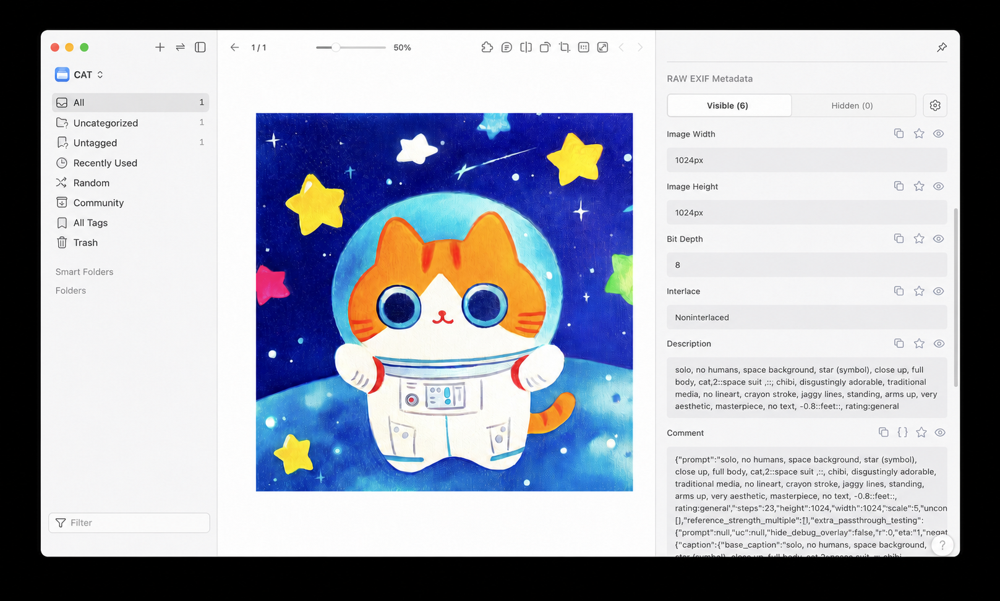
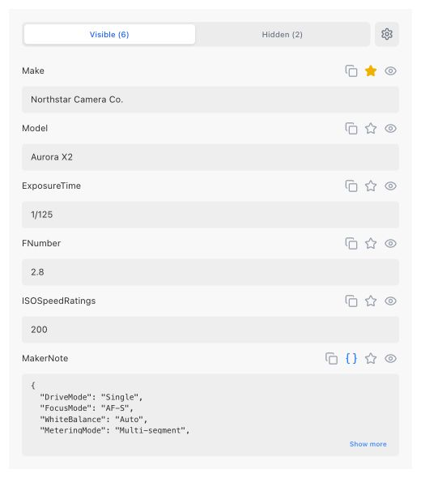
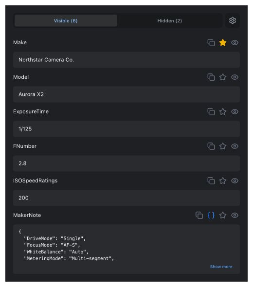

# [Eagle] RAW EXIF Metadata

[](https://github.com/tuki0918/eagle-raw-exif-inspector/releases/tag/v2.2.5)
[](https://community-en.eagle.cool/plugin/1152a2b2-499f-4d4e-afd2-2554fe44808a)
[](https://community-en.eagle.cool/plugin/1152a2b2-499f-4d4e-afd2-2554fe44808a)




[Eagle](https://eagle.sjv.io/RGANON)

## Features

A quick EXIF viewer plugin for PNG, JPEG, and WebP images.

- **Favorites** — Pin frequently used metadata fields for quick access
- **Field visibility** — Show only the metadata you need
- **One-click copy** — Copy metadata values instantly
- **JSON formatting** — Make structured metadata easier to read

| Light | Dark |
| --- | --- |
|  |  |

### Settings

Preferences are saved locally.

| Setting | Default | Description |
| --- | --- | --- |
| Format JSON automatically | On | Pretty-print structured metadata such as ComfyUI and NovelAI data. Nested hierarchy expansion remains manual. |
| Collapse long values | On | Show a compact preview of long values and expand them with **Show more**. |
| Show favorites first | On | Display favorited fields before other visible fields. |
| Show full paths for nested fields | Off | Display technical paths such as `parameters.seed`. |
| Include field name when copying | Off | Copy `Model: XYZ` instead of only `XYZ`. |
| Auto-save to annotation | Off | Preserve existing annotation text and update only the managed EXIF block. Identical metadata is not saved again. |

<details>
<summary>Also supports images from:</summary>

- `ComfyUI Workflows`
- `Stable Diffusion`
- `NovelAI`
- `Midjourney`
- `Nijijourney`

</details>

## Installation

Eagle Community: [Plugin page](https://community-en.eagle.cool/plugin/1152a2b2-499f-4d4e-afd2-2554fe44808a)

or, Manual Installation: [GitHub Releases page](https://github.com/tuki0918/eagle-raw-exif-inspector/releases)

## Usage

```sh
npm ci
npm run build
```

- Import the `dist` folder as a plugin in Eagle App.

## Contributing

Contributions are welcome! Feel free to open issues or submit pull requests to improve the plugin.
